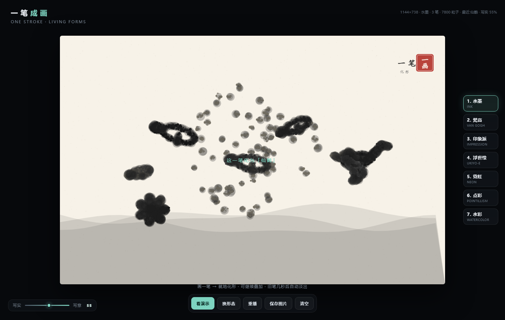

# 一笔成画 · One Stroke

> 画一笔,它会散成粒子、流动、聚成一个形态;再画一笔,画面继续叠加。八种画风,二十多种形态,单文件离线运行。



## 特性

- **一笔成形**:每一笔根据长度、方向、弯曲度、闭合程度,自动选择不同形态(飞鸟、锦鲤群、蝴蝶、仙鹤、龙、山水、人影、竹、梅、小舟、亭、鹿、猫、云、月……)
- **就地化形**:形态生成在这一笔的包围盒内,画在哪就在哪,不会全部聚到画面中央
- **多笔叠加**:旧笔不会因为新笔而消失
- **按时间淡出**:单笔基础停留 7.5 秒;当画面占比超过 55%,旧笔寿命被压缩;超过 92%,最旧的笔直接移除
- **八种画风**:水墨 / 梵高 / 印象派 / 浮世绘 / 霓虹 / 点彩 / 水彩 / 自定义
- **自定义风格**:自选背景色 + 最多 6 种笔触颜色(可增删改)
- **写实 ↔ 写意滑杆**:实时改变粒子大小、密度、流动强度与拖尾长度
- **鼠标扰动**:移动鼠标可以吹散粒子
- **单文件、离线、手机可用**:一个 `index.html`,不依赖任何框架或后端

## 快速开始

```bash
# 直接双击 index.html,或:
python -m http.server 8080
# 打开 http://localhost:8080
```

## 操作

| 操作 | 说明 |
|---|---|
| 拖动画一笔 | 松手后自动成形 |
| 继续画 | 叠加新的笔触,旧笔保留 |
| 移动鼠标 | 吹散粒子(不按鼠标也可以) |
| 1 – 8 | 切换画风 |
| 空格 | 播放三笔演示 |
| 底部滑杆 | 写实 ↔ 写意 |
| 看演示 / 保存图片 / 清空 | 三个核心按钮 |

## 目录

```
index.html        主文件(单文件应用)
preview/          截图
LICENSE           MIT
```

## 技术说明

- 纯 Canvas 2D,无第三方依赖
- 每笔触采样为粒子,粒子在「笔迹位置 → 目标形态位置」之间用缓动 + 流场偏移过渡
- 形态通过参数化几何函数生成(贝塞尔曲线、椭圆、散点),按包围盒缩放
- 生命周期按画面覆盖率动态调整:覆盖率越高,旧笔寿命越短;超过硬上限直接淘汰
- 双画布:背景层 + 粒子拖尾层,拖尾用 `destination-out` 逐帧衰减

关键常量(在 `index.html` 内):

```js
const BASE_LIFE = 7.5;   // 单笔基础寿命(秒)
const MIN_VISIBLE = 5.5; // 最新一笔的最短可见时间
const FORM_GRACE = 3.0;  // 成形期:未超过这个时间不参与淘汰
const COVER_SOFT = 0.55; // 画面占比超过 55% 开始压缩
const COVER_HARD = 0.92; // 超过 92% 才考虑移除最旧笔
const MAX_TOTAL = 12000; // 全屏粒子上限
const MAX_COLORS = 6;    // 自定义风格最大颜色数
```

## Roadmap

- [ ] 更多形态(马、鱼群、建筑、器物)
- [ ] 笔触强度/湿度参数
- [ ] 导出 GIF / WebM
- [ ] 触屏手势优化
- [ ] 预设配色方案

## License

MIT © 2026 林贤耀 (YoRay)
